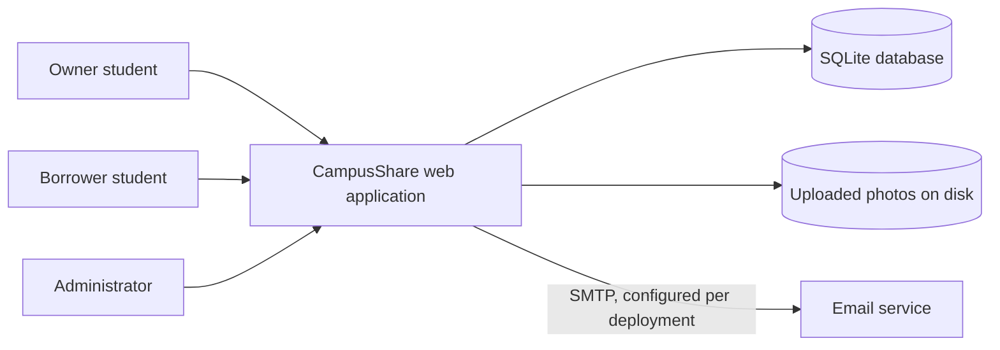
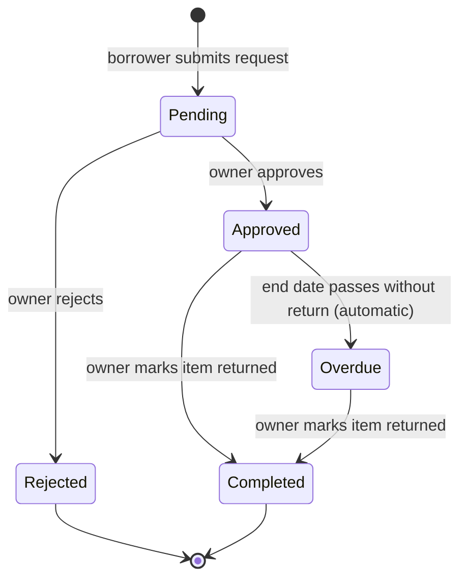
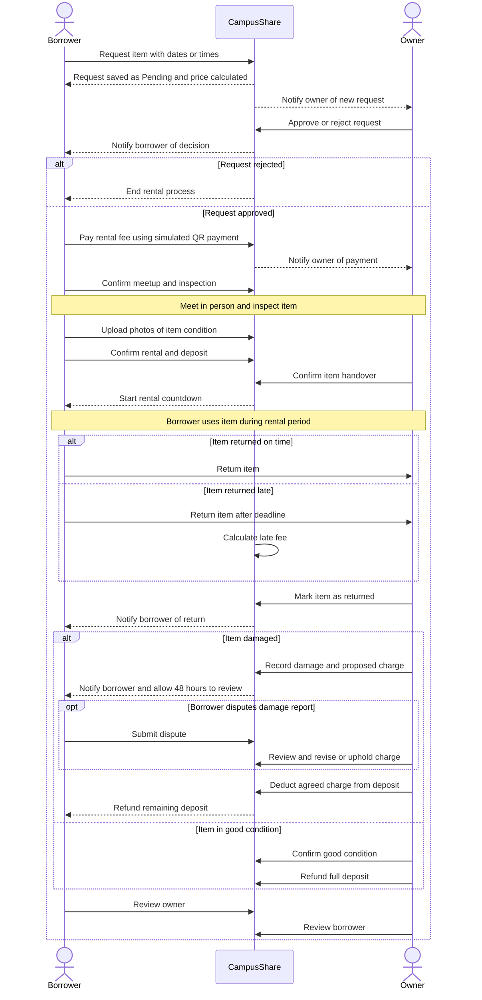
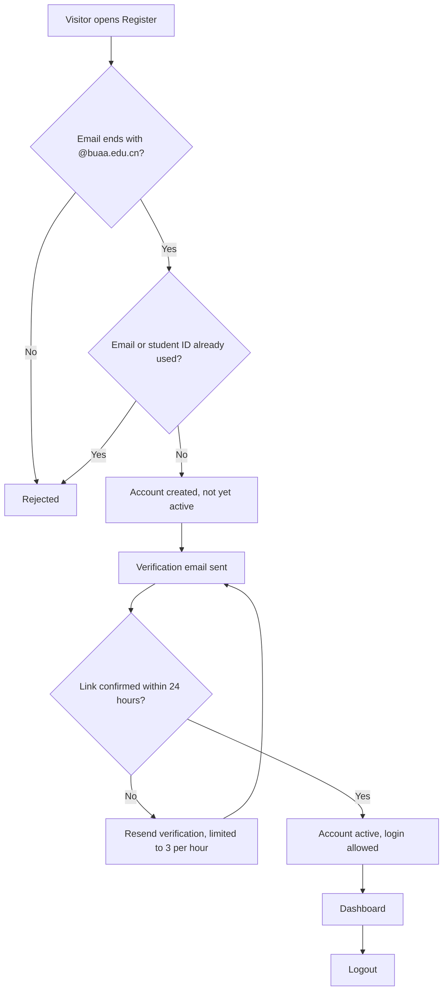

# CampusShare: Software Requirements Specification (SRS)

| | |
|---|---|
| **Project** | CampusShare (Team 26F) |
| **Document** | Software Requirements Specification |
| **Version** | v0.3 (draft for team review) |
| **Date** | 2026-10-27 |
| **Author** | Sandra Masiwa (system design and documentation) |
| **Team** | Turay Edward Joe (backend and business logic), Amanda Nancy Skaikay (requirements analysis and usability review), Sandra Masiwa (system design and documentation) |
| **Standard followed** | ISO/IEC/IEEE 29148:2018 (structure adapted for a course project) |
| **Application baseline** | Branch `joe-work` (snapshot dated 2026-10-26), reviewed 2026-10-27. Not yet merged into `main` |
| **Location** | `docs/requirements/SRS.md` |

## Revision history

| Version | Date | Author | Change |
|---|---|---|---|
| v0.1 | 2026-10-18 | Sandra Masiwa | First draft, based on review of the first prototype (`main`, commit `2403816`) and manual testing |
| v0.2 | 2026-10-22 | Sandra Masiwa | Statuses revised after retesting the first prototype; status legend extended |
| v0.3 | 2026-10-27 | Sandra Masiwa | Re-baselined against branch `joe-work`: statuses checked by running the 76 automated tests and reading the code; new requirements added for features built since v0.1; Appendix A rewritten to show what was resolved |

## Table of contents

1. [Introduction](#1-introduction)
2. [Overall description](#2-overall-description)
3. [Specific requirements](#3-specific-requirements)
4. [Process flows](#4-process-flows)
5. [Verification and traceability](#5-verification-and-traceability)
6. [Open issues for team decision](#6-open-issues-for-team-decision)
7. [Appendix A: Gaps found in the first prototype](#appendix-a-gaps-found-in-the-first-prototype)

---

## 1. Introduction

### 1.1 Purpose

This document specifies the requirements of CampusShare, a web application that lets Beihang University students lend and borrow equipment. It is written for the development team, the instructor, and the peer-review teams. It describes what the system must do, which requirements the current application already meets, and which it does not.

### 1.2 Scope

**CampusShare** lets a student list equipment they own, lets other students browse and request it, and supports the whole loan: approval, payment status, deposit handling, return, damage assessment and disputes, ratings, messaging, and notifications. An administrator role handles moderation.

**Out of scope (unless the team decides otherwise, see section 6):** real online payment processing, delivery or logistics, and users outside Beihang University.

### 1.3 Definitions

| Term | Meaning |
|---|---|
| Owner (lender) | A registered user who has listed an item |
| Borrower | A registered user who has requested an item |
| Listing | An equipment record created by an owner |
| Request / rental | A borrowing request, which becomes a rental once approved |
| Deposit | An amount set by the owner and held against damage or loss |
| Late fee | A charge for returning an item after the agreed end date |
| Dispute | A borrower's objection to a damage report, raised within 48 hours |
| Administrator | A user whose email is on the configured allowlist |
| SRS | Software Requirements Specification |

### 1.4 References

1. ISO/IEC/IEEE 29148:2018, *Systems and software engineering: Life cycle processes: Requirements engineering*
2. ISO/IEC/IEEE 42010:2022, *Architecture description*
3. Software Engineering GitHub Operations Guide (course)
4. `docs/requirements/user-roles-and-permissions.md` (roles and permissions detail)
5. `docs/design/design.md` (architecture and design description)
6. Source code and README of branch `joe-work`

### 1.5 Conventions

- Requirements use the word **shall**. Each has a unique ID.
- **ID format:** `FR-<area>-<nn>` for functional, `SEC-<nn>` for security, `NFR-<area>-<nn>` for non-functional.
- **Priority** (MoSCoW): **M** = Must, **S** = Should, **C** = Could.
- **Status** of the current application:
  - **Done**: works as specified, confirmed by an automated test, by running the code, or by reading it (see section 5.2).
  - **Partial**: works in part, or works with a known limitation.
  - **Missing**: not implemented.
  - **To verify**: not yet confirmed.
  - **Under study**: the team is assessing whether it is feasible.
- **Verification** method planned: **T** = test, **D** = demonstration, **I** = inspection of code or documents.

### 1.6 Overview

Section 2 describes the product and its users. Section 3 lists the requirements. Section 4 shows the main process flows. Section 5 explains how requirements are verified. Section 6 lists decisions for the team. The appendix records the gaps found in the first prototype and what became of them.

---

## 2. Overall description

### 2.1 Product perspective

CampusShare is a standalone web application. Users access it through a browser. The server stores all data in a single SQLite database file and uploaded photos on local disk. Email is sent through an SMTP service configured at deployment.

### 2.2 Product functions (summary)

1. Register with email confirmation, log in, log out, and reset a password
2. Create, edit, and delete equipment listings with photos, priced per day or per hour
3. Browse, search, and filter listings
4. Request equipment for a date range or time range, with a live cost estimate
5. Approve or reject requests (owner)
6. Record payment, deposit, return, late fees, damage, and disputes
7. Review owners and borrowers after completed rentals
8. Message other students, including from an item or a request, and see unread counts
9. Receive in-app notifications, optional email notifications, and return reminders
10. Administer the platform: remove listings, suspend accounts, resolve damage disputes

### 2.3 User classes

CampusShare has one account type with a role field. Full detail is in `user-roles-and-permissions.md`.

| Role | Description |
|---|---|
| Visitor | Not logged in. Can view the home and browse pages and register or log in |
| Registered user | Verified, logged-in student. Can list items, request items, message, and review |
| Owner | Registered user who owns a given listing. Can approve, reject, complete rentals, and handle deposits and damage for that listing |
| Borrower | Registered user who made a given request. Can pay, dispute damage reports, and review |
| Administrator | Provisioned only from the `CAMPUSSHARE_ADMIN_EMAILS` allowlist. Can remove listings, suspend non-administrator accounts, and resolve damage disputes |

### 2.4 Operating environment

- Python 3.9 or newer with Flask 3.1.3, Flask-WTF 1.2.2, and qrcode with Pillow (listed in `requirements.txt`)
- SQLite database file `campusshare.db`, created on first run
- Developed on Windows with Python 3.14; a macOS run was reported; the automated tests also passed on Linux with Python 3.12 in the reviewer's run
- The development server binds to `127.0.0.1` only. Deployment requires a production server behind an HTTPS proxy (see SEC-12)

### 2.5 Constraints

- Registration is limited to Beihang University email addresses (`@buaa.edu.cn`).
- The project is developed by a student team within one semester. Deadlines: SRS in Week 7, design in Week 11, product launch in Week 16.
- No real payment gateway is available to the team. Payments are simulated.

### 2.6 Assumptions and dependencies

- Users meet in person to hand over and return items. The system records the loan but does not move the item.
- A working SMTP account is needed for verification, password-reset, and notification emails.
- Return reminders and database backups need an operating-system scheduler. Scripts are provided for Windows.

---

## 3. Specific requirements

### 3.1 External interfaces

| ID | Requirement | Pri | Status | Ver |
|---|---|---|---|---|
| FR-EXT-01 | The system shall provide a browser-based user interface for all functions. | M | Done | D |
| FR-EXT-02 | The system shall store all persistent data in a relational database. | M | Done | I |
| FR-EXT-03 | The system shall send email to users for account verification, password reset, and optional notifications. | M | Partial | T |

*FR-EXT-03 note:* email sending is implemented and tested with a simulated mail server. Delivery through a real SMTP account to a real inbox has not been verified (README, "Still to do").

### 3.2 Functional requirements

#### 3.2.1 Accounts and authentication

| ID | Requirement | Pri | Status | Ver |
|---|---|---|---|---|
| FR-AUTH-01 | The system shall let a visitor register by providing name, university email, student ID, password, and password confirmation. | M | Done | T |
| FR-AUTH-02 | The system shall accept registration only for email addresses ending in `@buaa.edu.cn`. | M | Done | T |
| FR-AUTH-03 | The system shall reject registration if the email or student ID is already registered. | M | Done | T |
| FR-AUTH-04 | The system shall let a user with a verified, non-suspended account log in with email and password, ignoring letter case in the email. | M | Testibg | T |
| FR-AUTH-05 | The system shall end the user's session on logout, and logout shall require a form submission protected against forgery. | M | Done | T |
| FR-AUTH-06 | The system shall let a user reset a forgotten password using a link sent to the registered email, valid for 30 minutes and usable once. | M | Partial | T |
| FR-AUTH-07 | The system shall let a user request a new verification email, limited to three requests per email and IP address per hour. | S | testing | T |

*FR-AUTH-06 note:* the link is emailed (no longer printed to the console) and expires after 30 minutes, but the code does not invalidate it after use, so it can be reused within the time limit.

#### 3.2.2 Equipment listings

| ID | Requirement | Pri | Status | Ver |
|---|---|---|---|---|
| FR-LST-01 | The system shall let a registered user create a listing with name, category, description, condition, sharing type (Free or Paid), price per day or per hour, deposit, availability dates, daily pickup and return times (hourly listings), and location. | M | Done | T |
| FR-LST-02 | The system shall reject a listing whose availability end date is before its start date. | M | Done | T |
| FR-LST-03 | The system shall reject a listing whose availability start date is in the past. | M | Done | T |
| FR-LST-04 | The system shall let an owner edit their own listings. | M | Done | T |
| FR-LST-05 | The system shall prevent deletion of a listing that has rental request history. | M | Done | T |
| FR-LST-06 | The system shall show each listing's status as Available, Pending, or Booked. | M | Done | T |
| FR-LST-07 | The system shall let an owner upload, replace, and remove a photo for a listing (JPG, PNG, or WebP, at most 5 MB, checked by file content). | S | Done | T |
| FR-LST-08 | The system shall let an owner offer hourly rentals within a daily pickup and return window. | S | Done | T |

*FR-LST-06 note:* a listing shows Booked as soon as it has one approved request, even if other dates are free (see section 6).
*FR-LST-07 note:* photos are stored on local disk, excluded from Git, and not covered by the database backup.

#### 3.2.3 Browse and search

| ID | Requirement | Pri | Status | Ver |
|---|---|---|---|---|
| FR-BRW-01 | The system shall list equipment, newest first. | M | Done | T |
| FR-BRW-02 | The system shall search listings by keyword in name, category, and description. | M | Done | T |
| FR-BRW-03 | The system shall filter listings by category and by status. | M | Done | T |
| FR-BRW-04 | The system shall show a detail page with description, condition, price, deposit, availability, location, owner name, photo, and status. | M | Done | T |
| FR-BRW-05 | The system shall not count a listing as available once its availability end date has passed. | S | Done | T |
| FR-BRW-06 | The system shall show results in pages of 24 listings and keep the search filters between pages. | S | Done | T |

#### 3.2.4 Borrowing requests

| ID | Requirement | Pri | Status | Ver |
|---|---|---|---|---|
| FR-REQ-01 | The system shall let a logged-in user request a listing for a date range, or for a time range on one day for hourly listings. | M | Done | T |
| FR-REQ-02 | The system shall reject a request on the user's own listing. | M | Done | T |
| FR-REQ-03 | The system shall reject a request whose dates or times are in the past, fall outside the listing's availability, or end before they start. | M | Done | T |
| FR-REQ-04 | The system shall reject a request that overlaps an existing pending or approved booking of the same listing. | M | Done | T |
| FR-REQ-05 | The system shall calculate the total price from the saved rate: whole days for daily rentals, and hours rounded up with a one-hour minimum for hourly rentals; zero for Free listings. | M | Done | T |
| FR-REQ-06 | The system shall show the borrower a running cost estimate while they choose dates or times, before they submit. | S | Done | D |
| FR-REQ-07 | The system shall let an owner approve or reject a request only while it is Pending. | M | Done | T |
| FR-REQ-08 | The system shall allow only these status changes: Pending to Approved, Pending to Rejected, Approved to Completed, Approved to Overdue (automatic after the end date), and Overdue to Completed. | M | Done | T |
| FR-REQ-09 | The system shall allow several non-overlapping bookings of one listing. | S | Done | T |
| FR-REQ-10 | The system shall show a borrower the time remaining on an approved rental. | C | Done | T |

*FR-REQ-06 note:* confirmed by reading the page script, not by an automated test.

#### 3.2.5 Payment, return, deposit, and damage

| ID | Requirement | Pri | Status | Ver |
|---|---|---|---|---|
| FR-PAY-01 | The system shall record the payment status (Unpaid or Paid) of each request. | M | Done | T |
| FR-PAY-02 | The system shall let the owner mark the deposit as Held only after payment is recorded as Paid. | M | Done | T |
| FR-PAY-03 | The system shall let the owner mark an approved or overdue rental as returned (Completed). | M | Done | T |
| FR-PAY-04 | The system shall calculate a late fee at return as the saved rate multiplied by the whole days after the agreed end date. | M | Done | T |
| FR-PAY-05 | The system shall let the owner record the item's condition on return as Good Condition, or as Damaged with a description and a non-negative charge within the held deposit. | M | Done | T |
| FR-PAY-06 | The system shall let the owner refund the deposit only when the rental is Completed, the deposit is Held, and the condition is Good Condition. | M | Done | T |
| FR-PAY-07 | The system shall apply a damage charge against the held deposit when an item is returned damaged. | S | Done | T |
| FR-PAY-08 | The system shall let the borrower view a damage report and dispute it within 48 hours before the charge is settled. | S | Done | T |
| FR-PAY-09 | The system shall mark a rental as Overdue when the end date has passed without a return. | S | Done | T |
| FR-PAY-10 | The system shall support online payment through an external provider. | C | Under study | D |
| FR-PAY-11 | The system shall let the borrower pay a late fee after the rental is completed. | S | Done | T |
| FR-PAY-12 | The system shall not let a rental with a price above zero be marked returned until its payment is recorded as Paid. | M | Done | T |

*FR-PAY-01 note:* payment is simulated. The borrower confirms by opening a QR code link that expires after 10 minutes. No money moves.
*FR-PAY-10 note:* depends on the team's decision on real payments (section 6).

#### 3.2.6 Ratings and reviews

| ID | Requirement | Pri | Status | Ver |
|---|---|---|---|---|
| FR-RAT-01 | The system shall let a borrower rate the owner from 1 to 5 stars with a comment, once per completed rental. | M | Done | T |
| FR-RAT-02 | The system shall let a user view the reviews they have received. | M | Done | T |
| FR-RAT-03 | The system shall show each user's average received rating on their dashboard. | S | Done | T |
| FR-RAT-04 | The system shall let an owner rate the borrower, once per completed rental. | C | Done | T |

#### 3.2.7 Messaging

| ID | Requirement | Pri | Status | Ver |
|---|---|---|---|---|
| FR-MSG-01 | The system shall let a registered user send a text message of up to 1,000 characters to another registered user. | M | Done | T |
| FR-MSG-02 | The system shall show a list of conversations with the latest message and unread count. | M | Done | T |
| FR-MSG-03 | The system shall mark messages as read when the recipient opens the conversation. | M | Done | T |
| FR-MSG-04 | The system shall let a user delete only messages they sent. | S | Done | T |
| FR-MSG-05 | The system shall let a borrower start a conversation with an item's owner from the item page (Message Owner button). | S | Done | T |
| FR-MSG-06 | The system shall let an owner start a conversation with a borrower from a request (Message Borrower link). | S | Done | T |

*FR-MSG-06 note:* confirmed by reading the code; the reviewer's script checked the Message Owner path.

#### 3.2.8 Notifications and reminders

| ID | Requirement | Pri | Status | Ver |
|---|---|---|---|---|
| FR-NTF-01 | The system shall create a notification for the relevant user when a request is received, approved, or rejected, and when a rental is paid, returned, assessed for damage, disputed, or overdue. | M | Done | T |
| FR-NTF-02 | The system shall create a notification when a user receives a new message. | M | Done | T |
| FR-NTF-03 | The system shall let a user mark their own notifications as read. | M | Done | T |
| FR-NTF-04 | The system shall remind a borrower 24 hours before the end date and when a rental becomes overdue. | S | Partial | T |
| FR-NTF-05 | The system shall offer email delivery of notifications, off by default and sent only to verified addresses. | C | Partial | D |
| FR-NTF-06 | The system shall show the number of unread private messages as a badge, and remove it when the messages are read. | S | Done | T |
| FR-NTF-07 | The system shall show the number of unread notifications as a badge. | S | Done | T |

*FR-NTF-04 note:* overdue notices are created automatically. The 24-hour reminder is created by the script `rental_reminders.py`, which must be run daily. A Windows Task Scheduler installer is provided, but none for macOS or Linux.
*FR-NTF-05 note:* the same SMTP limitation as FR-EXT-03.
*FR-NTF-06 note:* the badge appears on the dashboard page (`dashboard.html`). Other pages were not checked.

#### 3.2.9 Administration

| ID | Requirement | Pri | Status | Ver |
|---|---|---|---|---|
| FR-ADM-01 | The system shall provide an Administrator role, assigned only from a configured allowlist and never selectable at registration. | S | Done | T |
| FR-ADM-02 | The system shall let an administrator remove listings from view and suspend or restore non-administrator accounts, without deleting rental history. | S | Done | T |
| FR-ADM-03 | The system shall let an administrator review and resolve disputes about damage charges. | C | Done | T |
| FR-ADM-04 | The system shall refuse login to suspended accounts and end their existing sessions on their next request. | S | Done | T |

*Documentation note:* the README lists administration both as completed and as "still to do". The code and tests show it is implemented.

### 3.3 Security requirements

| ID | Requirement | Pri | Status | Ver |
|---|---|---|---|---|
| SEC-01 | The system shall activate an account only after the user confirms a link sent to the registered university email. | M | Done | T |
| SEC-02 | The system shall require passwords of 8 to 128 characters that are not on a list of common passwords. | M | Done | T |
| SEC-03 | The system shall store passwords only as salted hashes. | M | Done | I |
| SEC-04 | The system shall read its secret key from configuration outside the source code and refuse to start without it. | M | Done | I |
| SEC-05 | The system shall protect every state-changing request against cross-site request forgery. | M | Done | T |
| SEC-06 | The system shall end sessions after 30 minutes of inactivity and shall set the cookie flags HttpOnly and SameSite, and Secure when served over HTTPS. | M | Done | T |
| SEC-07 | The system shall block further login attempts for 15 minutes after 5 failed attempts for the same account. | M | Done | T |
| SEC-08 | The system shall check on the server that the acting user owns the listing or request, and that the request is in a valid state, before any owner-only or borrower-only action. | M | Done | T |
| SEC-09 | The system shall validate all input on the server (types, ranges, dates, lengths) and respond with a clear, styled error page instead of failing. | M | Partial | T |
| SEC-10 | The system shall use parameterized database queries for all data access. | M | Done | I |
| SEC-11 | The system shall make password-reset links single-use and shall not reveal whether an email is registered. | M | Partial | T |
| SEC-12 | The system shall bind the development server to the local machine only and shall be served over HTTPS in deployment. | M | Partial | I |
| SEC-13 | The system shall show other users only a name, not an email address or student ID. | M | Done | T |
| SEC-14 | The system shall not write secrets, tokens, or reset links to logs or consoles. | M | Done | T |
| SEC-15 | The system shall escape user-supplied text on every page to prevent script injection. | M | Done | I |
| SEC-16 | The system shall log security-relevant events (failed logins, approvals, deposit changes, damage decisions, dispute decisions) without recording credentials or personal text. | S | Done | T |

*SEC-01 note:* the logic is tested. The student ID itself is still not checked against any source (section 6).
*SEC-09 note:* many validations are tested (dates, amounts, files, passwords), but completeness for every field has not been demonstrated.
*SEC-11 note:* the reset response is the same for known and unknown emails (tested). Links are not invalidated after use.
*SEC-12 note:* the server binds to `127.0.0.1`, and production mode requires a trusted HTTPS proxy, redirects HTTP, and sets HSTS. No HTTPS deployment exists yet.
*SEC-15 note:* confirmed by inspection: templates use automatic escaping, and no template uses the `safe` filter.

### 3.4 Non-functional requirements

| ID | Requirement | Pri | Status | Ver |
|---|---|---|---|---|
| NFR-PERF-01 | The system shall return browse and search results within 2 seconds for 95% of requests with 1,000 listings and 50 simultaneous users. *(proposed target, to confirm)* | S | Done | T |
| NFR-USE-01 | The system shall show validation messages beside the form fields, keep submitted values after an error, and prevent selecting past dates in date pickers. | S | Done | T |
| NFR-USE-02 | The system shall show consistently styled error pages instead of plain text messages. | S | Done | T |
| NFR-USE-03 | The system shall be usable on screens from 360 px wide. | S | To verify | D |
| NFR-REL-01 | The system shall enforce database referential integrity so that no record refers to a deleted record. | M | Done | T |
| NFR-REL-02 | The system shall back up the database at least once a day. | S | Partial | I |
| NFR-MNT-01 | The project shall provide a `requirements.txt` listing all dependencies. | M | Done | I |
| NFR-MNT-02 | The project shall split the application into modules and include automated tests for the request lifecycle and access control. | S | Partial | I |
| NFR-POR-01 | The system shall run on macOS, Windows, and Linux with Python 3. | S | Done | D |

*NFR-PERF-01 note:* the benchmark `performance_test.py` uses an in-process test client. The developer measured p95 of about 0.88 seconds on Windows. The reviewer's run on Linux measured p95 of 1.37 seconds, which is within the target. This is not a real-network or production-host measurement.
*NFR-USE-03 note:* checked down to 450 px only.
*NFR-REL-02 note:* `database_backup.py` makes consistent copies and a Windows scheduler installer exists. On macOS and Linux the team must schedule it. Uploaded photos are not backed up.
*NFR-MNT-02 note:* 76 automated tests exist and pass. The application is split into `app.py`, `campusshare_routes.py`, and `database.py`, but the routes remain in one file of about 3,700 lines.
*NFR-POR-01 note:* macOS was reported by the team, Windows is the development system, and the test suite passed on Linux.

### 3.5 Data requirements

| Entity | Key attributes |
|---|---|
| users | id, name, email (unique), student_id (unique), password hash, email verified, role, suspended, email notifications enabled |
| equipment | id, owner, name, category, description, condition, sharing type, price, price unit, deposit, availability dates, pickup and return times, location, photo path, removed flag |
| borrowing_requests | id, equipment, borrower, start and end date and time, status, payment status, deposit status, price unit and rate, total price, late fee and its status, damage status, report, charge and report time, dispute status, reason, and resolution |
| ratings | id, request, rater, rated user, rating (1 to 5), comment, time |
| messages | id, sender, receiver, text, time, read flag |
| notifications | id, user, message, link, read flag, time |
| rental_reminders | request, reminder type, time (prevents duplicate reminders) |
| login_attempts, verification_email_attempts | email, IP address, time (for throttling) |

Allowed values: **status** is Pending, Approved, Rejected, Overdue, or Completed. **Payment status** is Unpaid or Paid. **Deposit status** is Pending, Held, Refunded, or Settled. **Damage status** is Not Checked, Good Condition, or Damaged. **Dispute status** starts as Not Disputed.

---

## 4. Process flows

### 4.1 Request lifecycle

The code now refuses other changes (FR-REQ-08).

### 4.2 Main borrowing flow

 

### 4.3 Account flow

---

## 5. Verification and traceability

### 5.1 Automated tests

The branch contains 76 automated tests, which all passed in the reviewer's run on 2026-10-27 (Linux, Python 3.12). They run with `python -m unittest discover -s tests -v` and use a temporary database. They cover registration and email verification, login lockout, sessions and cookies, CSRF, password rules, administrator actions, listing and rental validation, hourly and daily pricing, status transitions, late fees, payment, deposit and damage handling, disputes, ratings, notifications and email, return reminders, photo upload, database integrity, backups, and error pages.

### 5.2 Statuses confirmed without an automated test

| Requirement | How it was checked |
|---|---|
| FR-REQ-06 live cost estimate | Read the script in `item_details.html` |
| FR-MSG-05 Message Owner button | Reviewer script: button present; message sent; owner notified |
| FR-MSG-06 Message Borrower link | Read `requests.html` and the route |
| FR-MSG-03, FR-NTF-02, FR-NTF-06 | Reviewer script: unread count rose to 1, then cleared when the owner opened the chat |
| FR-NTF-07 | Read the code |
| SEC-10 no string-built SQL | Searched the code; none found |
| SEC-15 output escaping | No `safe` filter or `render_template_string` found |
| NFR-PERF-01 | Reviewer ran `performance_test.py` |

### 5.3 Acceptance test cases (manual)

| Test | Requirement | Expected result |
|---|---|---|
| TC-01 Register with a Gmail address | FR-AUTH-02 | Registration refused |
| TC-02 Register with a valid address, try to log in before confirming | SEC-01 | Login refused until the link is confirmed |
| TC-03 List an item starting yesterday | FR-LST-03 | Listing refused |
| TC-04 Request your own item | FR-REQ-02 | Request refused |
| TC-05 Request 3 days of a Paid item at 10 per day | FR-REQ-05 | Total price is 30 |
| TC-06 Request overlapping dates after an approved booking | FR-REQ-04 | Refused; non-overlapping dates accepted |
| TC-07 Try to approve a rejected request | FR-REQ-08 | Action refused |
| TC-08 Return an item 2 days late at 10 per day | FR-PAY-04 | Late fee is 20 |
| TC-09 Mark Damaged without a description | FR-PAY-05 | Refused with a message |
| TC-10 Open another user's edit page by its address | SEC-08 | Access refused |
| TC-11 Submit a form without a security token | SEC-05 | Request refused |
| TC-12 Six wrong passwords in a row | SEC-07 | Account locked for 15 minutes |
| TC-13 Send a message containing a script tag | SEC-15 | Shown as text, not run |
| TC-14 Use Message Owner, send a message, log in as the owner | FR-MSG-05, FR-NTF-06 | Owner sees a badge with 1 unread message |
| TC-15 Open the conversation as the owner | FR-NTF-06 | Badge disappears |
| TC-16 Use a password reset link twice | SEC-11 | Second use should be refused (currently accepted) |
| TC-17 View the app on a 360 px wide screen | NFR-USE-03 | No sideways scrolling |

---

## 6. Open issues for team decision

### 6.1 Decisions settled by the implementation

Hourly borrowing and the Administrator role are now in scope and built. Please confirm this is the intended scope.

### 6.2 Questions still open

| # | Question | Why it matters |
|---|---|---|
| 1 | Should browsing stay public? | Visitors can open the browse page without logging in |
| 2 | Is real payment in scope, or only the simulated flow? | Decides FR-PAY-10 and the deposit design |
| 3 | How is a student ID verified, and against what source? | Email confirmation proves the email, not the student ID |
| 4 | Do Free items carry a late fee or deposit penalty? | The late fee is rate multiplied by days, which is zero for free items |
| 5 | Should a listing with one booking still show Booked for its free dates? | Now that several bookings are allowed, the label may mislead |
| 6 | Who sets up HTTPS, SMTP, and the schedulers for the demonstration? | SEC-12, FR-EXT-03, FR-NTF-04, and NFR-REL-02 depend on it |
| 7 | Should password-reset links be invalidated after use? | Closes the remaining part of SEC-11 |
| 8 | Which `Partial` and `To verify` items will be finished before Week 16? | Fixes the scope for the demonstration |

---

## Appendix A: Gaps found in the first prototype

The first review (v0.1, 2026-10-17 and 2026-10-18) found these gaps in `main`. The third column shows their state on branch `joe-work`.

| ID | Observation in the first prototype | State on `joe-work` | Requirement |
|---|---|---|---|
| G-01 | A made-up `@buaa.edu.cn` email and student ID were accepted | Partly resolved: email must be confirmed; student ID still unchecked | SEC-01 |
| G-02 | Past dates could be chosen as availability dates | Resolved | FR-LST-03 |
| G-03 | Validation messages appeared only after submission | Resolved: errors beside fields, values kept | NFR-USE-01 |
| G-04 | No option to upload an image | Resolved | FR-LST-07 |
| G-05 | Unexpected logouts while moving between pages | Open to verify: sessions now expire after 30 minutes idle by design; cause of the earlier logouts not confirmed | SEC-06 |
| G-06 | Any password was accepted | Resolved | SEC-02 |
| G-07 | No time of day, so hourly borrowing was impossible | Resolved | FR-LST-08 |
| G-08 | Damage button failed; no countdown or overdue state | Resolved | FR-PAY-05, FR-REQ-10, FR-PAY-09 |
| G-09 | No notification when a request arrived or changed | Resolved | FR-NTF-01 |
| G-10 | No live cost calculator and no reminders | Cost estimate resolved; reminders Partial (need a scheduler) | FR-REQ-06, FR-NTF-04 |
| G-11 | No in-app payment; Paid was only a label | Partly resolved: simulated QR payment; no real money | FR-PAY-01, FR-PAY-10 |
| G-12 | Secret key written in the source | Resolved | SEC-04 |
| G-13 | No CSRF protection | Resolved | SEC-05 |
| G-14 | Student directory showed every user's name and email | Resolved | SEC-13 |
| G-15 | Reset link printed to the console and reusable | Partly resolved: emailed and not printed; still reusable | FR-AUTH-06, SEC-11, SEC-14 |
| G-16 | Request status changes were not checked | Resolved | FR-REQ-08 |
| G-17 | Deleting a listing deleted its rental history | Resolved | FR-LST-05 |
| G-18 | Server listened on all network addresses | Resolved | SEC-12 |
| G-19 | Foreign keys were not enforced | Resolved | NFR-REL-01 |
| G-20 | No `requirements.txt` | Resolved | NFR-MNT-01 |
| G-21 | Rating reported as not implemented at retest | Resolved: both parties can review | FR-RAT-01, FR-RAT-04 |
| G-22 | Retest on `main` (2026-10-22): editing listings, price, late fee, reviews, and message notifications did not work | Resolved on `joe-work` | FR-LST-04, FR-REQ-05, FR-PAY-04, FR-RAT-02, FR-NTF-02 |

### Gaps found in the 2026-10-27 review of `joe-work`

| ID | Observation | Requirement |
|---|---|---|
| G-23 | Password-reset links are not invalidated after use | SEC-11, FR-AUTH-06 |
| G-24 | Email delivery through a real SMTP account has not been verified | FR-EXT-03, FR-NTF-05 |
| G-25 | Return reminders and database backups need a scheduler; scripts exist for Windows only | FR-NTF-04, NFR-REL-02 |
| G-26 | Uploaded photos are stored on local disk and are not backed up | FR-LST-07, NFR-REL-02 |
| G-27 | The unread message badge appears only on the dashboard page | FR-NTF-06 |
| G-28 | All route handlers are in one file of about 3,700 lines | NFR-MNT-02 |
| G-29 | The 360 px screen width has not been tested | NFR-USE-03 |
| G-30 | A listing shows Booked after one approved request, even when other dates are free | FR-LST-06 |
| G-31 | . Security Deposit Display
- The item description should display the required security deposit.
- The estimated rental cost should clearly state that the security deposit is not included in the rental fee.
2. Meetup and Physical Inspection
- Once a borrower requests an item, the system should prompt the borrower and owner to arrange a physical meetup.
- Both parties must meet and inspect the item before the rental is confirmed.
- The borrower should confirm whether they wish to proceed after inspecting the item.
3. Item Condition Documentation
- If the borrower agrees to proceed, they should be able to take and upload pictures of the item's current condition.
- These pictures will serve as evidence of the item's condition at the time of collection and can be compared against its condition upon return.
4. Rental Payment
- After documenting the item's condition, the borrower should proceed with the rental and payment.
- The system should clearly display the rental fee and security deposit separately.
5. Approval Workflow
- The current approval workflow needs to be revised.
- The owner should only approve the rental after the borrower has completed the required inspection, condition documentation, and payment.
- The system should not display the Mark as Returned option immediately after approval.
6. Rental Countdown and Return Tracking
- Introduce a timer or countdown based on the agreed borrowing period.
- The countdown should begin when the rental is confirmed and the item is handed over.
- The owner should be able to mark the item as returned once it has been physically returned.
7. Late Return and Penalties
- Introduce a late-return policy for items returned after the agreed deadline.
- The system should calculate late fees based on the duration of the delay and the applicable penalty rate.
- Notify the borrower when the return deadline is approaching or has passed.
8. Security Deposit Refund
- After the item is returned, the owner should inspect its condition.
- If the item is returned in good condition, the security deposit should be refunded to the borrower.
- If damage is identified, the system should support documenting the damage and determining any applicable deductions according to the agreed policy.
9. Hourly Rental Rates
- Introduce an hourly rental rate in addition to the existing rental pricing options.
- The system should calculate the rental cost based on the selected hourly or daily borrowing period. | All |
